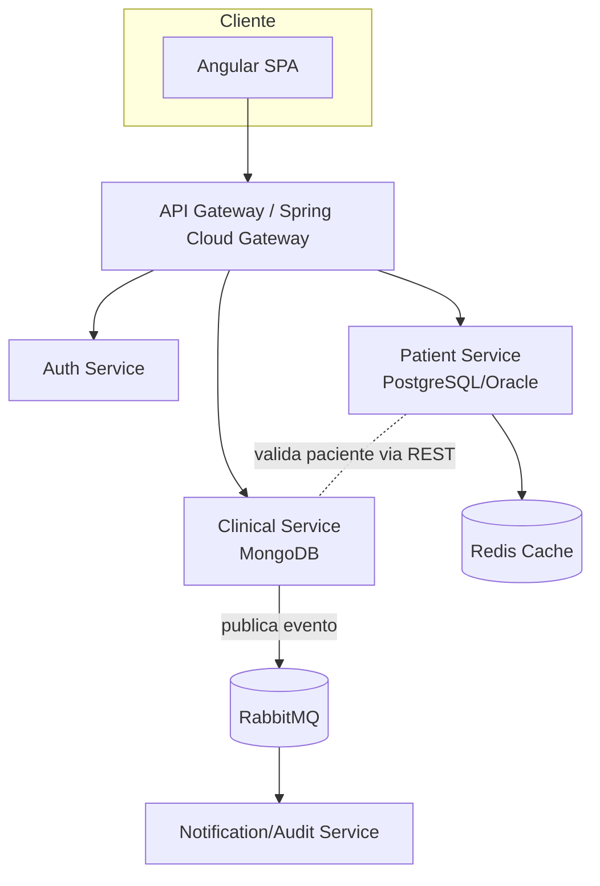

# Documentação Técnica — Prontuário Eletrônico do Paciente (PEP) Simplificado

> Projeto de portfólio alinhado à vaga de Desenvolvedor Júnior na MV, estendido com tópicos de nível sênior (modelagem poliglota, cloud, microsserviços/mensageria, DevOps) para demonstrar capacidade de evolução técnica.

---

## 1. Visão Geral

O PEP Simplificado é um hub centralizador de informações clínicas. Em vez de o médico abrir múltiplos sistemas ou procurar papéis, ele consulta tudo em um único lugar: dados cadastrais do paciente, histórico de consultas, alergias, prescrições e notas de evolução clínica.

O projeto é deliberadamente desenhado em **fases crescentes de complexidade**. Isso é proposital: começar direto com microsserviços, Kubernetes e três bancos de dados diferentes é um erro comum que gera abandono do projeto. A estratégia aqui é construir um MVP funcional rápido e, a partir dele, evoluir a arquitetura — exatamente como acontece em empresas reais, e é uma ótima história para contar em entrevista ("comecei simples, identifiquei o gargalo X, e evoluí para Y").

### 1.1 Personas

- **Médico/Enfermeiro**: consulta histórico do paciente, registra nova nota de evolução, prescrição ou alergia.
- **Administrativo**: cadastra/atualiza dados básicos do paciente (nome, CPF, nascimento, contato).
- **Administrador do sistema**: gerencia usuários e permissões.

### 1.2 Casos de uso principais (MVP)

1. Cadastrar paciente (CPF, nome, data de nascimento, contato).
2. Buscar paciente por CPF ou ID.
3. Listar histórico clínico paginado de um paciente (consultas, alergias, prescrições).
4. Registrar nova nota de evolução clínica.
5. Autenticar usuário e restringir ações por papel (RBAC).

---

## 2. Decisões de Arquitetura

### 2.1 Por que separar dados relacionais e não-relacionais

| Domínio | Característica dos dados | Banco escolhido | Justificativa |
|---|---|---|---|
| Cadastro do paciente, usuários, vínculo paciente↔consulta | Estrutura fixa, forte necessidade de integridade referencial e busca exata por CPF/ID | **PostgreSQL** (dev/local) / **Oracle** (alinhado ao stack da MV em produção) | Dados cadastrais não mudam de formato; CPF precisa de unicidade garantida por constraint. |
| Notas de evolução, alergias, prescrições | Estrutura variável (uma prescrição tem campos diferentes de uma nota de evolução; alergias podem ganhar novos atributos sem migração) | **MongoDB** | Schema flexível evita migrations constantes; cada registro clínico é um documento independente, ideal para leitura rápida do histórico completo de um paciente em uma única query. |

Essa divisão é o que normalmente se chama de **persistência poliglota**: cada serviço usa o banco mais adequado ao seu domínio, em vez de forçar tudo em uma única tecnologia.

### 2.2 Por que (e quando) microsserviços

Para o MVP, recomenda-se um **monólito modular** (um único deploy, mas pacotes Java bem separados por domínio: `patient`, `clinical`, `auth`, `shared`). Isso evita a complexidade operacional de múltiplos serviços antes de haver motivo real para ela.

A partir da Fase 2, o módulo `clinical` é extraído para um serviço independente, porque:
- Tem um banco diferente (Mongo vs Postgres/Oracle), o que já é um forte indicador de fronteira de serviço.
- Tem um padrão de carga diferente (muita leitura concorrente do histórico, picos de escrita ao final de cada atendimento).
- Permite escalar independentemente do serviço de cadastro.



### 2.3 Comunicação entre serviços

- **Síncrona (REST)**: quando o Clinical Service precisa validar que um `pacienteId` existe antes de gravar uma nota, ele chama o Patient Service via REST. Toda chamada síncrona entre serviços tem **timeout, retry e circuit breaker** (ver seção 6), porque uma chamada sem proteção é a causa mais comum de efeito cascata ("um serviço lento derruba todos os outros").
- **Assíncrona (mensageria)**: eventos que não precisam de resposta imediata (ex.: "nota clínica criada" para fins de auditoria/notificação) são publicados em uma fila (RabbitMQ). Isso desacopla o serviço que grava o dado do serviço que reage a ele, e evita que uma falha no serviço de auditoria impeça o médico de salvar a nota.

---

## 3. Modelagem de Dados

### 3.1 Modelo relacional (Patient Service)

```sql
CREATE TABLE paciente (
    id              BIGSERIAL PRIMARY KEY,
    cpf             VARCHAR(11) NOT NULL UNIQUE,
    nome            VARCHAR(150) NOT NULL,
    data_nascimento DATE NOT NULL,
    telefone        VARCHAR(20),
    email           VARCHAR(150),
    criado_em       TIMESTAMP NOT NULL DEFAULT now(),
    versao          INTEGER NOT NULL DEFAULT 0  -- usado para optimistic locking (@Version)
);

CREATE INDEX idx_paciente_cpf ON paciente (cpf);

CREATE TABLE usuario (
    id        BIGSERIAL PRIMARY KEY,
    nome      VARCHAR(150) NOT NULL,
    email     VARCHAR(150) NOT NULL UNIQUE,
    senha_hash VARCHAR(255) NOT NULL,
    papel     VARCHAR(20) NOT NULL CHECK (papel IN ('MEDICO','ENFERMEIRO','ADMIN'))
);
```

O índice em `cpf` existe porque essa é a busca mais frequente do sistema (médico procurando paciente). A coluna `versao` habilita **bloqueio otimista**: se dois administrativos editarem o mesmo paciente ao mesmo tempo, o segundo `UPDATE` falha com `OptimisticLockException` em vez de sobrescrever silenciosamente o dado do primeiro.

### 3.2 Modelo documental (Clinical Service / MongoDB)

```json
{
  "_id": "ObjectId(...)",
  "pacienteId": 1024,
  "tipo": "EVOLUCAO_CLINICA",
  "dataRegistro": "2026-06-17T14:30:00Z",
  "profissionalId": 55,
  "conteudo": {
    "queixaPrincipal": "Dor abdominal há 2 dias",
    "observacoes": "Paciente afebril, abdome flácido",
    "conduta": "Solicitar exames de imagem"
  },
  "criadoEm": "2026-06-17T14:31:02Z"
}
```

Cada documento tem o campo `tipo` (`EVOLUCAO_CLINICA`, `ALERGIA`, `PRESCRICAO`), e o sub-objeto `conteudo` varia de formato conforme o tipo — é exatamente isso que justifica o NoSQL: um schema relacional teria várias colunas nulas dependendo do tipo de registro, ou exigiria várias tabelas com joins caros para montar o histórico completo. No Mongo, uma única query `find({pacienteId: 1024}).sort({dataRegistro: -1})` retorna o histórico inteiro ordenado.

Índice recomendado: `{ pacienteId: 1, dataRegistro: -1 }` (índice composto), para que a busca de histórico — a operação mais frequente — seja sempre um index scan, não um full collection scan.

---

## 4. Especificação de API (padrões REST)

Convenções adotadas em todos os serviços:

- Recursos no plural: `/api/v1/pacientes`, `/api/v1/registros-clinicos`.
- Versionamento na URL (`/v1/`) para permitir evolução sem quebrar clientes existentes.
- Listagens **sempre paginadas** (`?page=0&size=20`), nunca um `findAll()` sem limite — isso é justamente uma das causas mais comuns de uma API "cair" sob carga real.
- Erros seguem o padrão **RFC 9457 (Problem Details)**, suportado nativamente pelo Spring Boot 3:

```json
{
  "type": "https://api.pep.mv/erros/paciente-nao-encontrado",
  "title": "Paciente não encontrado",
  "status": 404,
  "detail": "Nenhum paciente com CPF 123.456.789-00",
  "instance": "/api/v1/pacientes/cpf/12345678900"
}
```

### 4.1 Principais endpoints (Patient Service)

| Método | Rota | Descrição |
|---|---|---|
| POST | `/api/v1/pacientes` | Cadastra paciente |
| GET | `/api/v1/pacientes/{id}` | Busca por ID |
| GET | `/api/v1/pacientes/cpf/{cpf}` | Busca por CPF |
| GET | `/api/v1/pacientes?page=0&size=20` | Lista paginada |
| PUT | `/api/v1/pacientes/{id}` | Atualiza (com checagem de versão) |

### 4.2 Principais endpoints (Clinical Service)

| Método | Rota | Descrição |
|---|---|---|
| POST | `/api/v1/registros-clinicos` | Cria registro (evolução, alergia ou prescrição) |
| GET | `/api/v1/registros-clinicos/paciente/{pacienteId}?page=0&size=20` | Histórico paginado, mais recente primeiro |

Toda escrita (`POST`) aceita um header `Idempotency-Key`: se a mesma chave for reenviada (ex.: o médico clicou duas vezes em "salvar" por uma conexão lenta), o serviço retorna o resultado já processado em vez de criar um registro duplicado.

---

## 5. Segurança

- **Autenticação**: JWT emitido após login (`/auth/login`), assinado com chave armazenada em secret manager (não em código).
- **Autorização**: RBAC simples — `MEDICO`/`ENFERMEIRO` podem ler e criar registros clínicos; `ADMIN` gerencia usuários; cadastro de paciente é liberado para todos os papéis autenticados.
- **Dados sensíveis**: CPF e dados de saúde são **dados sensíveis pela LGPD** (Lei 13.709/2018, art. 5º, II). Práticas mínimas: HTTPS obrigatório, CPF nunca aparece em logs, criptografia em repouso no banco (TDE no Oracle / `pgcrypto` no Postgres), e log de auditoria de quem acessou o quê (é justamente o papel do Notification/Audit Service da seção 2.2).
- **Spring Security**: filtro JWT customizado, `@PreAuthorize` nos métodos de controller por papel.

---

## 6. Resiliência e Tratamento de Erros

Esta é a seção mais importante para fugir do "nível júnior". O objetivo é que a aplicação **degrade graciosamente** em vez de quebrar.

### 6.1 Connection pool do banco

```yaml
spring:
  datasource:
    hikari:
      maximum-pool-size: 20
      minimum-idle: 5
      connection-timeout: 3000      # falha rápido em vez de empilhar requisições
      max-lifetime: 1800000
      leak-detection-threshold: 5000
```

Um pool sem `connection-timeout` configurado faz a aplicação **inteira** travar quando o banco fica lento — todas as threads ficam esperando indefinidamente por uma conexão.

### 6.2 Circuit breaker e retry entre serviços (Resilience4j)

```yaml
resilience4j:
  circuitbreaker:
    instances:
      patientService:
        sliding-window-size: 10
        failure-rate-threshold: 50
        wait-duration-in-open-state: 10s
  retry:
    instances:
      patientService:
        max-attempts: 3
        wait-duration: 200ms
  timelimiter:
    instances:
      patientService:
        timeout-duration: 2s
```

```java
@CircuitBreaker(name = "patientService", fallbackMethod = "fallbackValidarPaciente")
@Retry(name = "patientService")
@TimeLimiter(name = "patientService")
public CompletableFuture<Boolean> validarPacienteExiste(Long pacienteId) {
    return CompletableFuture.supplyAsync(() -> patientClient.existe(pacienteId));
}

private CompletableFuture<Boolean> fallbackValidarPaciente(Long pacienteId, Throwable t) {
    log.warn("Patient Service indisponível, assumindo validação otimista para paciente {}", pacienteId);
    return CompletableFuture.completedFuture(true); // decisão de negócio: não bloquear o atendimento
}
```

O `fallback` aqui é uma decisão de produto, não só técnica: em um sistema de saúde, é frequentemente preferível permitir o registro da nota clínica mesmo se o serviço de validação estiver fora, e reconciliar depois, do que impedir o médico de documentar um atendimento.

### 6.3 Tratamento global de exceções

```java
@RestControllerAdvice
public class GlobalExceptionHandler {

    @ExceptionHandler(PacienteNaoEncontradoException.class)
    public ProblemDetail handlePacienteNaoEncontrado(PacienteNaoEncontradoException ex) {
        ProblemDetail pd = ProblemDetail.forStatus(HttpStatus.NOT_FOUND);
        pd.setTitle("Paciente não encontrado");
        pd.setDetail(ex.getMessage());
        return pd;
    }

    @ExceptionHandler(OptimisticLockException.class)
    public ProblemDetail handleConcorrencia(OptimisticLockException ex) {
        ProblemDetail pd = ProblemDetail.forStatus(HttpStatus.CONFLICT);
        pd.setTitle("Registro foi modificado por outro usuário, recarregue e tente novamente");
        return pd;
    }

    @ExceptionHandler(Exception.class)
    public ProblemDetail handleGenerico(Exception ex) {
        log.error("Erro não tratado", ex);
        ProblemDetail pd = ProblemDetail.forStatus(HttpStatus.INTERNAL_SERVER_ERROR);
        pd.setTitle("Erro interno, tente novamente em breve");
        return pd; // nunca expor stacktrace ou detalhe interno ao cliente
    }
}
```

### 6.4 Outras práticas de robustez

- **Validação de entrada** com Bean Validation (`@NotBlank`, `@CPF` customizado) — rejeitar dado inválido na borda, antes de chegar ao banco.
- **Cache** (Redis) para buscas de paciente por CPF, com TTL curto (ex.: 60s) e invalidação no `UPDATE` — reduz carga no banco para a consulta mais repetida do sistema.
- **Rate limiting** no Gateway (`spring-cloud-gateway` + Redis) para proteger contra picos anormais de requisições.
- **Testes de integração com Testcontainers**: sobem um Postgres e um Mongo reais em container durante o `mvn test`, evitando o problema clássico de "passou no H2, quebrou em produção".

---

## 7. Observabilidade

- **Logs estruturados em JSON** (Logback + `logstash-logback-encoder`), nunca `System.out.println`.
- **Trace ID de correlação**: Micrometer Tracing (substituto do Sleuth no Spring Boot 3) propaga um `traceId` por toda a cadeia Gateway → Patient Service → Clinical Service, permitindo seguir uma requisição específica nos logs de todos os serviços.
- **Métricas**: Spring Boot Actuator + Micrometer expondo `/actuator/prometheus`, com dashboards no Grafana (latência, taxa de erro, uso do pool de conexões).
- **Health checks**: `/actuator/health/liveness` e `/actuator/health/readiness`, usados diretamente como probes do Kubernetes (seção 9).

---

## 8. Estrutura de Pastas (monorepo)

```
pep-mv/
├── pep-gateway/
├── pep-patient-service/
│   └── src/main/java/com/mv/pep/patient/
│       ├── controller/
│       ├── service/
│       ├── repository/
│       ├── domain/
│       ├── exception/
│       └── config/
├── pep-clinical-service/
│   └── src/main/java/com/mv/pep/clinical/
├── pep-frontend/
│   └── src/app/
│       ├── core/
│       ├── features/pacientes/
│       └── features/historico/
├── infra/
│   ├── docker-compose.yml
│   ├── k8s/
│   └── ci/
└── docs/
```

---

## 9. Containerização e CI/CD

### 9.1 `docker-compose.yml` (ambiente local)

```yaml
version: "3.9"
services:
  postgres:
    image: postgres:16
    environment:
      POSTGRES_DB: pep_patient
      POSTGRES_PASSWORD: changeit
    ports: ["5432:5432"]

  mongo:
    image: mongo:7
    ports: ["27017:27017"]

  rabbitmq:
    image: rabbitmq:3-management
    ports: ["5672:5672", "15672:15672"]

  redis:
    image: redis:7
    ports: ["6379:6379"]

  patient-service:
    build: ./pep-patient-service
    depends_on: [postgres, redis]
    ports: ["8081:8080"]

  clinical-service:
    build: ./pep-clinical-service
    depends_on: [mongo, rabbitmq]
    ports: ["8082:8080"]

  gateway:
    build: ./pep-gateway
    depends_on: [patient-service, clinical-service]
    ports: ["8080:8080"]
```

### 9.2 Pipeline CI/CD (GitHub Actions)

```yaml
name: CI
on: [push, pull_request]

jobs:
  build-and-test:
    runs-on: ubuntu-latest
    services:
      postgres:
        image: postgres:16
        env: { POSTGRES_PASSWORD: test }
        ports: ["5432:5432"]
    steps:
      - uses: actions/checkout@v4
      - uses: actions/setup-java@v4
        with: { java-version: "21", distribution: "temurin" }
      - run: mvn -B verify
      - name: Build Docker image
        run: docker build -t pep-patient-service:${{ github.sha }} ./pep-patient-service
```

### 9.3 Kubernetes (exemplo simplificado de manifest)

```yaml
apiVersion: apps/v1
kind: Deployment
metadata:
  name: patient-service
spec:
  replicas: 2
  selector:
    matchLabels: { app: patient-service }
  template:
    metadata:
      labels: { app: patient-service }
    spec:
      containers:
        - name: patient-service
          image: patient-service:latest
          ports: [{ containerPort: 8080 }]
          readinessProbe:
            httpGet: { path: /actuator/health/readiness, port: 8080 }
            initialDelaySeconds: 10
          livenessProbe:
            httpGet: { path: /actuator/health/liveness, port: 8080 }
            initialDelaySeconds: 20
          resources:
            requests: { cpu: "250m", memory: "512Mi" }
            limits: { cpu: "500m", memory: "768Mi" }
```

`replicas: 2` já demonstra entendimento de alta disponibilidade; os probes conectados ao Actuator mostram que o Kubernetes só envia tráfego para instâncias realmente saudáveis.

---

## 10. Cloud (GCP e OCI)

Como a vaga cita GCP e/ou OCI, vale montar a infraestrutura pensando nos dois — a tabela abaixo mapeia os serviços equivalentes, e a documentação do projeto pode descrever ambos como opções de deploy.

| Necessidade | OCI | GCP |
|---|---|---|
| Banco relacional gerenciado | Autonomous Database / OCI Database with PostgreSQL | Cloud SQL (PostgreSQL) |
| Orquestração de containers | OKE (Container Engine for Kubernetes) | GKE |
| Mensageria | OCI Streaming (compatível com Kafka) | Pub/Sub |
| Armazenamento de objetos (ex.: anexos de exames) | Object Storage | Cloud Storage |
| Monitoramento/Logging | OCI Monitoring + Logging | Cloud Monitoring + Cloud Logging |
| Cache gerenciado | OCI Cache with Redis | Memorystore |

Recomenda-se documentar a escolha como **OCI por padrão** (coerente com o fato de a MV usar Oracle como banco principal), com nota explícita de que a arquitetura é portável para GCP — isso já demonstra raciocínio de arquitetura agnóstica de fornecedor.

---

## 11. Roadmap de Implementação

| Fase | Entregável | Foco |
|---|---|---|
| 0 | Repositório, estrutura de pastas, `docker-compose` com Postgres+Mongo | Setup |
| 1 | Monólito modular: CRUD de paciente + registro clínico, login JWT, Angular básico consumindo a API | MVP funcional |
| 2 | Extração do Clinical Service (Mongo) + Gateway + chamada REST entre serviços com Resilience4j | Microsserviços |
| 3 | Mensageria (RabbitMQ) para eventos de auditoria + Redis cache | Mensageria/Performance |
| 4 | Testes (unitário + Testcontainers), tratamento global de erros, paginação, idempotência | Robustez |
| 5 | Dockerfiles, CI no GitHub Actions, manifests Kubernetes locais (kind/minikube) | DevOps |
| 6 | Deploy em OKE ou GKE, observabilidade (Grafana/Prometheus), hardening LGPD | Cloud + Produção |

Cada fase pode (e deve) virar uma branch/PR separada no repositório, com seu próprio README explicando a decisão tomada — isso é, por si só, uma evidência de maturidade técnica para quem for avaliar o portfólio.

---

## 12. Stack Final

Java 21 · Spring Boot 3 · Spring Security · Spring Data JPA · Spring Data MongoDB · Spring Cloud Gateway · Resilience4j · RabbitMQ · Redis · PostgreSQL/Oracle · MongoDB · Angular (standalone components) · TypeScript · SCSS · Docker · Kubernetes · GitHub Actions · OCI/GCP.
